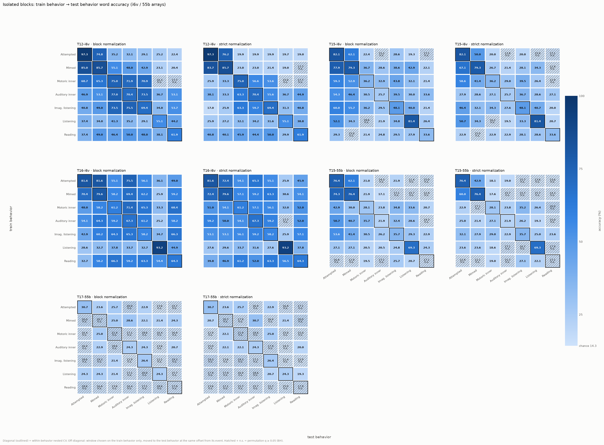
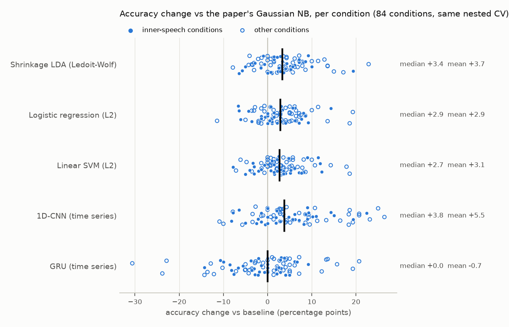

# Kunz et al. 2025 reproduction (Phases 0–3)

Reproduction and extension of the isolated-word decoding analysis of Kunz et al. 2025, *Cell*,
"Inner speech in motor cortex and implications for speech neuroprostheses" (PMC12360486), using the
public Dryad dataset ([doi:10.5061/dryad.gf1vhhn1j](https://doi.org/10.5061/dryad.gf1vhhn1j)) and the
conventions of the official code ([nptl-stanford/inner_speech](https://github.com/nptl-stanford/inner_speech)).
Data structure and method details: [`docs/DATA_NOTES.md`](docs/DATA_NOTES.md).

Related: the BIT sentence-decoding experiments live at [molinzhao27/BIT-Experiments](https://github.com/molinzhao27/BIT-Experiments).

## Setup

```bash
git clone --recurse-submodules https://github.com/molinzhao27/KunzInnerSpeechReproduction.git
cd KunzInnerSpeechReproduction
uv venv --python 3.14 .venv && uv pip install -e ".[dev,dl]"  # or: python -m venv .venv && pip install -e ".[dev,dl]"
python scripts/fetch_data.py list                              # file list + sizes; pins configs/dryad_manifest.json
```

Dryad's API needs an OAuth token to download files. Either set `DRYAD_TOKEN` (or `DRYAD_CLIENT_ID` and
`DRYAD_CLIENT_SECRET`) and run `python scripts/fetch_data.py download --required-only`, or download the
zips by hand from the [dataset page](https://datadryad.org/dataset/doi:10.5061/dryad.gf1vhhn1j) into
`data/raw/`. Then:

```bash
python scripts/fetch_data.py verify      # sizes + sha-256 against the Dryad API
python scripts/fetch_data.py extract --required-only   # read-only extraction into data/raw/<name>/
```

`data/` is gitignored and `data/raw/` is never modified after extraction. Preprocessed features are
cached in `data/processed/` (~3 GB per smoothing σ).

## Running

| Phase | Command | Outputs | Time |
|---|---|---|---|
| 0: data inventory | `python scripts/phase0_explore.py` | `results/phase0/`, `figures/phase0_*.png` | ~1 min |
| 1: Fig 1E reproduction | `python scripts/phase1_isolated_words.py [--variants none]` | `results/phase1/`, `figures/phase1_fig1e_heatmap.png` | ~1 min per variant (CPU) |
| 3: decoder comparison | `python scripts/phase3_models.py --models lda_shrinkage logreg svm` (CPU), `--models cnn gru` (GPU), then `--compare-only` | `results/phase3/`, `figures/phase3_model_comparison.png` | linear ~10 min on 24 cores; CNN 10 min + GRU 3 h on the RTX PRO 6000 |
| 2: behavior transfer | `python scripts/phase2_transfer.py --prepare-only` (CPU caches), then `python scripts/phase2_transfer.py` | `results/phase2/*_corrected.*`, `figures/phase2_*_corrected.png` | 41 min on a Mac CPU (M5 Pro, 1000 permutations); `--n-perm 20` for a quick check |
| tests | `python -m pytest tests` | | seconds |

Settings live in `configs/*.yaml`. Every split is seeded (`seed: 42`), and results are identical on
macOS and on the Linux GPU host.

## Method (Phase 1)

- **Features:** per array, 64 threshold-crossing + 64 spike-band-power channels (128 features; 256 for the
  two-array sets T16-6d and T17-55b).
- **Preprocessing:** block-wise mean subtraction, then Gaussian smoothing (σ = 100 ms, as in the official
  code; the paper text says 60 ms), then z-scoring.
- **Window:** the mean over a 500 ms window. Its start (100 ms grid) is chosen by **nested** 10-fold CV:
  inner folds pick the start, outer folds evaluate.
- **Classifier:** Gaussian naive Bayes with a pooled, class-shared variance. This is the official
  `fitcdiscr 'diaglinear'`, i.e. diagonal LDA.
- **Statistics:** Clopper-Pearson 95% CI; significant if the lower bound > 14.3% (chance for 7 words).

## Results

### Phase 1: Fig 1E reproduction


Sanity check against the paper:

| Condition | Paper | This repo [95% CI] |
|---|---|---|
| T16-i6v listening | 92.1% | 93.2% [87.8–96.7] |
| T12-i6v motoric inner speech | 72.6% | 75.0% [68.3–80.9] |
| T12-i6v attempted vocalized | 97.9% | 97.3% [93.2–99.3] |

All three paper values fall inside our CIs. Full table with CIs: `results/phase1/accuracy_table.md`;
per-trial predictions, chosen windows per fold, confusion matrices and inner-CV window curves are in
`results/phase1/`.

- **Significance pattern:** the arrays the paper drops (T16-PEF, T16-6d) are at chance for every behavior.
- **T17-55b:** in our run it is narrowly significant for 6 of 7 behaviors (21–31%, lower bounds
  15–23%). The paper leaves it out of Fig 1E, which implies it wasn't significant there.

**Variants**, all under the same CV (`results/phase1/variant_comparison.csv`):

| Variant | Mean accuracy (84 conditions) | Significant | T16 listen / T12 motoric / T12 attempted |
|---|---|---|---|
| **Primary**: pooled-variance GNB, σ = 100 ms | 36.7% | 54 | 93.2 / 75.0 / 97.3 |
| sklearn-style GNB (per-class variance), σ = 100 ms | 33.8% (−2.9 pp) | 48 | 90.5 / 67.3 / 95.9 |
| pooled-variance GNB, σ = 60 ms (paper text) | 36.8% (+0.1 pp) | 54 | 94.6 / 74.5 / 98.0 |

- **Smoothing:** σ barely matters.
- **Classifier variance model:** per-class variances (sklearn's `GaussianNB`) hurt. Use the
  pooled-variance version (the official one) as the baseline.

### Phase 2: perception → intent transfer

**What was done.** For every array that was significant in Phase 1:
- **Train and test:** train the Phase 1 decoder on one behavior and test it once on every other
  behavior. This gives a 7 × 7 train × test matrix per array; the diagonal is the Phase 1
  within-behavior result.
- **Window choice:** the 500 ms window is chosen by 10-fold CV on the *training* behavior only. It is
  then moved to the test behavior at the same offset from that behavior's event (stimulus onset for
  listening/reading, the go cue otherwise). No test-behavior label is used for fitting or for picking
  the window.
- **Statistics:** Clopper-Pearson 95% CIs and 1000-permutation nulls; q = Benjamini-Hochberg within each
  dataset × normalization family.
  - *Transfer cells:* the decoder trained on the true training labels is kept fixed, and the test
    behavior's word labels are permuted within recording blocks (every block holds each word equally
    often). This tests the claim itself: the decoder's predictions carry information about the test words.
  - *Diagonal cells:* the whole nested CV, window selection included, is re-run on permuted labels, with
    the folds re-stratified on them exactly as for the true labels.
  - These nulls replace the first version's (audit 2026-10-19, item 5). It shuffled the *training* labels,
    which tests whether the training behavior has word information rather than whether the decoder
    predicts the test words. Its diagonal folds also stayed stratified on the true labels. Point
    accuracies and CIs are unchanged. The original files are kept next to the corrected ones, and the
    cells whose call changed are listed in `results/phase2/significance_changes_corrected.csv`.
- **Normalization:** both the paper's per-block normalization and a **strict** version (center and
  scale with training-behavior statistics only).
- **Drift control:** the **interleaved** sessions, where three behaviors share every block.

Full matrices with CIs and q-values: `results/phase2/matrices_corrected.md`. Key directions:
`results/phase2/key_transfers_corrected.md`. Every cell: `results/phase2/transfer_results_corrected.csv`.
The untagged files in `results/phase2/` are the first version's, kept for comparison.



Mean accuracy (%) when testing on the three inner-speech behaviors (motoric, auditory, imagined
listening). Chance is 14.3%; transfer index = (cross − chance) / (within − chance):

| Train on | Array | Isolated, paper norm. | Isolated, strict | Interleaved (shared blocks) |
|---|---|---|---|---|
| Listening | T12-i6v | 35.2 (3/3 sig.) | 32.7 (3/3) | 35.7 (Motor; q = 0.003) |
| | T16-i6v | 34.7 (3/3) | 31.0 (3/3) | 24.3 (Aud; q = 0.003) |
| | T15-i6v | 25.1 (2/3) | 23.0 (2/3) | 25.6 (ImagL; q = 0.003) |
| | T15-55b | 21.9 (3/3) | 17.5 (1/3) | 18.5 (ImagL; q = 0.031) |
| | T17-55b | 19.5 (1/3) | 18.6 (1/3) | 17.7 (ImagL; n.s.) |
| Reading | T12-i6v | 48.1 (3/3) | 46.8 (3/3) | — (not recorded) |
| | T16-i6v | 62.9 (3/3) | 58.8 (3/3) | — |
| Attempted | T12-i6v | 32.1 (3/3) | 19.9 (3/3) | 35.0 (Motor) |
| | T16-i6v | 62.2 (3/3) | 58.2 (3/3) | 27.1 (mimed → Aud) |

**Findings**
1. **Perception → inner speech transfers.**
   - **Listening:** a decoder trained only on listening decodes inner speech well above chance on the
     i6v arrays of T12, T16 and T15 (T15: auditory inner speech and imagined listening only), and on
     T15-55b. The transfer index is about 0.3–0.5: the listening decoder recovers roughly a third to a
     half of inner speech's own above-chance decodability. On T17-55b one cell is now significant
     (listening → motoric inner, 21.4%, q = 0.022, paper normalization only).
   - **Reverse direction:** decoders trained on inner speech also decode listening (11/15
     priority-array cells significant) and reading (11/15).
2. **Reading → inner speech is even stronger** (T16-i6v ≈ 63%, T12-i6v ≈ 48%). There is a caveat:
   inner-speech trials show the word as text during the delay, and the timing maps show reading
   decoders generalize best right after go. Part of this transfer may be cue-reading activity
   rather than inner speech itself. The windows the protocol actually used (0.5–1.3 s after go) avoid
   the delay epoch, but we can't tell whether the text stays on screen during go.
3. **Transfer is not an artifact of normalization or drift.**
   - **Strict normalization:** on the i6v arrays, listening/reading → inner survive it with a 1–4 point
     drop. T15-55b's weaker listening transfer largely does not: 1 of 3 cells survives, and only
     narrowly (listening → motoric inner, 18.6%, q = 0.049).
   - **Interleaved blocks:** listening → inner is significant there for T12-, T15- and T16-i6v and
     for T15-55b (18.5%, q = 0.031), where block-wise centering cannot remove behavior-specific offsets
     and drift can't line up with behavior.
4. **Overt → inner transfer is fragile under strict normalization in T12** (attempted 32 → 20%,
   mimed 49 → 22%). The same direction stays at 35% in T12's interleaved session. That suggests the
   drop comes from block-to-block drift in the isolated recording rather than a fixed overt-vs-inner
   offset. These are different sessions, though, so this is suggestive only.
5. **The timing maps** (`figures/phase2_tgm_*.png`, diagnostic only) show that listening decoders
   trained on *late* activity, 1–1.75 s after the audio starts (after the word has ended), generalize
   to inner speech more broadly than the window chosen at the listening peak. The transfer numbers
   above are therefore conservative with respect to the window rule.
6. **What the corrected nulls changed** (`results/phase2/significance_changes_corrected.csv`, 43 of 1000
   cells). No conclusion above reverses. 36 borderline transfer cells (17–23% accuracy) become
   significant and 4 stop being significant; for 19 of the 43, the old or the new q is within 0.01 of
   0.05. Three within-behavior cells lose significance: T17-55b motoric inner speech (21.4%) and mimed
   (20.7%), both at q = 0.054, and T17-s6v-A reading (20.7%, q = 0.089). Phase 1's interval rule still
   calls all three significant, so these borderline arrays depend on the test used.

**Caveats**
- **Isolated blocks confound behavior with block.** Each block holds one behavior, so the paper's
  per-block centering adapts to the test behavior using unlabeled data. The strict column removes this
  but leaves drift uncorrected; read the two columns as rough upper and lower bounds.
- **The interleaved sessions are cleaner but limited.** They are different days from the isolated
  sessions (except T17), have three behaviors per participant, include no reading, and for T15–T17
  play the listening audio at go instead of during the delay.
- **How the nulls are built:** transfer cells permute the test labels within blocks against a fixed
  decoder; diagonal cells re-run the nested CV, folds re-stratified, on every permutation. With 1000
  permutations the smallest attainable p is 0.001, and p near 0.05 carries a Monte Carlo SE of about 0.007.

### Phase 3: beating the baseline decoder

**Setup.**
- **Same task, same data:** the same 84 conditions, the same word trials, and the same outer and inner folds
  (seed 42) as Phase 1.
- **Settings chosen in the inner folds only:** every model picks its own settings there:
  - window-average models: the 500 ms window and the regularization strength;
  - sequence models: weight decay and training length.
- **Sequence-model input:** the binned (80 ms) time series over the span Phase 1's window search covers.
- **Statistics:** each condition is compared with the baseline on the same trials (McNemar, BH-corrected).
  The 84 conditions are not independent replicates: they are 12 arrays × 7 behaviors from 4 participants, and a
  participant's arrays record the same trials. The mean Δ therefore gets bootstrap intervals that resample whole
  arrays, whole recording sessions (participant × behavior), or arrays and behaviors together (two-way), and the
  gain is also reported per participant. The first version's condition-level CI and Wilcoxon p
  (`results/phase3/model_comparison.md`) treated the 84 conditions as independent; they are superseded
  (audit 2026-10-19, item 6).



| Model | Input | Mean acc. (84) | Paper's 9 arrays | Inner speech | Significant | Δ vs baseline | 95% CI, by array | 95% CI, array × behavior | Participants improved | Better / worse |
|---|---|---|---|---|---|---|---|---|---|---|
| Gaussian NB, pooled variance (paper) | 500 ms mean | 36.7 | 43.6 | 28.7 | 54/84 | — | — | — | — | — |
| Shrinkage LDA (Ledoit-Wolf) | 500 ms mean | 40.5 | 48.3 | 31.7 | 55/84 | +3.7 | [+1.9, +5.6] | [+1.5, +6.3] | 4/4 | 8 / 0 |
| Logistic regression (L2) | 500 ms mean | 39.6 | 47.4 | 30.7 | 52/84 | +2.9 | [+1.2, +4.6] | [+0.8, +5.3] | 3/4 (1 tie) | 4 / 1 |
| Linear SVM (L2) | 500 ms mean | 39.8 | 47.3 | 31.3 | 55/84 | +3.1 | [+1.3, +5.0] | [+1.0, +5.5] | 3/4 | 4 / 0 |
| **1D-CNN** | binned time series | **42.2** | **50.5** | **32.9** | **56/84** | **+5.5** | **[+3.0, +8.0]** | **[+2.0, +9.5]** | **4/4** | **15 / 0** |
| GRU | binned time series | 36.1 | 43.5 | 27.7 | 50/84 | −0.7 | [−2.6, +1.4] | [−3.7, +2.2] | 2/4 | 3 / 5 |

Intervals are 95% percentile bootstraps (10,000 resamples) of the mean Δ that resample the 12 arrays, or the
arrays and the 7 behaviors independently. Resampling the 28 recording sessions gives intervals close to the
by-array ones (CNN [+3.3, +7.9]). Per-participant gains for the CNN: T12 +3.7, T15 +7.4, T16 +6.9, T17 +2.6 pp.
All intervals and per-participant gains: `results/phase3/model_comparison_clustered.md`.

**Findings**
- **Modelling electrode noise correlations helps.** The paper's Gaussian NB assumes independent electrodes.
  Shrinkage LDA, which models their shared noise, gains +3.7 points and is never significantly worse in any condition.
- **Integrating over the whole trial helps; whether temporal *dynamics* help is not established.** The small CNN on
  the binned time series is best overall: +5.5 points, significantly better in 15 conditions and worse in none,
  including inner speech (28.7 → 32.9%). But it sees the whole candidate span (~5 s for active behaviors, ~2 s for
  passive ones), while the window models see one 500 ms window. Its gains are largest where one window covers the
  least of the behavior: attempted +9.1, mimed +9.8, reading +6.8. They vanish for listening (−0.2), whose word
  information is a brief, time-locked burst that one window already captures. So the gain is at least partly
  coverage. A control with multi-window features in a linear model would separate coverage from dynamics; it was
  not run.
- **The paper's significance map is robust to the decoder; its borderline cells are not.** The better decoders
  change the significance of only 3–5 of the 84 cells, all of them on borderline arrays (T17-55b, T17-s6v,
  T16-PEF, T12-s6v; accuracies around 20%). With 84 uncorrected interval tests, a few flips are expected anyway.
- **The GRU does not beat the baseline.** Treat that as inconclusive rather than negative: its inner-fold search
  still chose the longest training (49% of fits) and the strongest weight decay (55%) — the edges of a grid that
  had already been widened once after a 4-condition smoke test (`configs/phase3.yaml`). The CNN also often chose
  the grid edges (29% and 53%), so its gain may be conservative.
- **The gains hold up when dependent conditions are kept together, but they are gains on four participants.**
  Intervals that resample whole arrays are 1.1–1.8× as wide as the first version's condition-level ones, and the
  two-way intervals 1.6–2.1× (CNN: [+3.8, +7.3] → [+3.0, +8.0] by array, [+2.0, +9.5] two-way). They still exclude
  zero for every model except the GRU. Shrinkage LDA and the CNN improve all four participants. Logistic
  regression improves three and ties on T17 (Δ = 0); the SVM improves three and is −0.1 on T12. The
  participants are the only independent units, and with four of them a two-sided sign test cannot go below
  p = 0.125. So these results show the decoders do better on this dataset; they do not establish that they
  would in a new participant.
- **These are benchmark comparisons, not new methods** (see `docs/NOVELTY.md`). Whether the stronger decoders
  change the Phase 2 transfer conclusions is a natural follow-up that was not run.

## Compute

| Phase | Work | Where |
|---|---|---|
| 0–1 | 84 conditions × nested 10×10 CV over 16–61 candidate windows; numpy, vectorized over windows | ~1 min CPU per variant (Mac or host). RAM < 4 GB |
| 2 | 10 arrays × 7×7 cells × 2 normalizations, plus 10 interleaved 3×3 matrices, each with a 1000-permutation null. Transfer cells score one fixed decoder against permuted test labels; the diagonal re-runs a nested CV, folds re-stratified, per permutation | **Measured: 41 min on the Mac CPU** (M5 Pro, torch float64, permutations batched as a tensor axis). The first version's null took 4.4 min on the RTX PRO 6000 |
| 3 | 84 conditions × nested 10×10 CV. Linear models: ~1.5 M sklearn fits. CNN/GRU: all inner-fold models of a condition trained as one stacked network | **Measured:** linear models 10 min on 24 host cores; CNN 10 min and GRU 3 h on the RTX PRO 6000 (the GRU's step loop is launch-bound) |

Disk: 4.3 GB of extracted raw data (2.5 GB on the host, which skips the redundant `allBehaviors` files),
plus ~3 GB of feature cache per smoothing σ.
