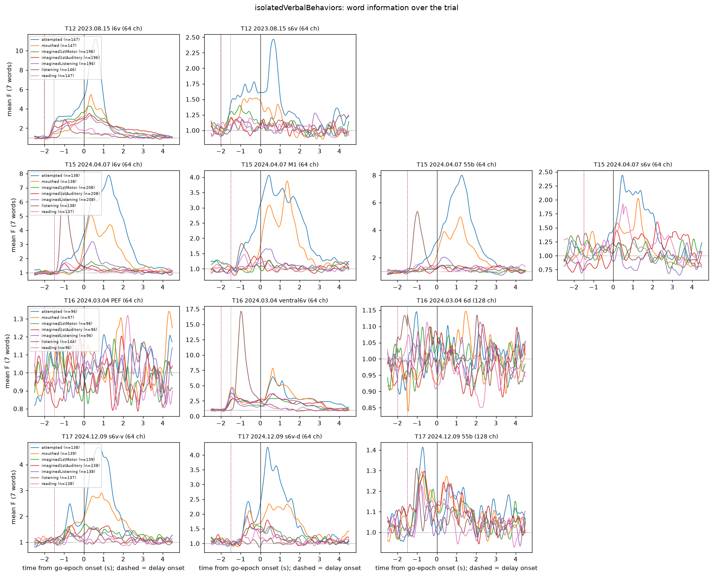
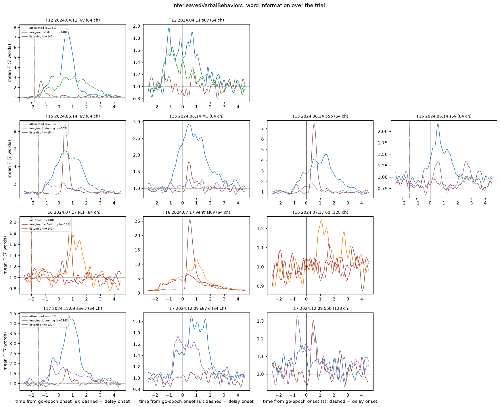

# Data notes: Kunz et al. 2025 (Cell), Dryad doi:10.5061/dryad.gf1vhhn1j

Regenerate the numbers here with `python scripts/phase0_explore.py`. It writes
`results/phase0/inventory.json`, `results/phase0/sessions.csv` and two figures:
`figures/phase0_word_info_timecourse*.png`.

## 1. Provenance

| Item | Value |
|---|---|
| Dataset | Dryad v2 (version id 379376), published 2025-07-30, 12 files, 10.80 GB. All sizes and sha-256 values verified against the API (`scripts/fetch_data.py verify`); pinned in `configs/dryad_manifest.json` |
| Download route | Manual from the landing page. API file downloads need an OAuth bearer token (HTTP 401) |
| Used here | `isolatedVerbalBehaviors.zip` (Figs 1–2) and `interleavedVerbalBehaviors.zip` (Fig 5/6). Both are extracted read-only to `data/raw/<name>/`. The other 10 archives stay zipped |
| Official code | [github.com/nptl-stanford/inner_speech](https://github.com/nptl-stanford/inner_speech) @ `66b7948` (2025-08-14). It isn't linked from the Dryad README; the paper's Key Resources table says "Repository provided upon acceptance". Cloned read-only to `external/inner_speech/` (gitignored). The Fig 1E script is `analysis/Fig1EF_7Behavior7WordDecoding.m` (MATLAB) |
| Format | MATLAB v5 `.mat`; `scipy.io.loadmat` works. Loader: `src/kunzdecoder/io.py` |

## 2. File layout

```
data/raw/isolatedVerbalBehaviors/
    t{12,15,16,17}.<date>_<behavior>_raw.mat   # 7 behaviors x 4 participants
    t{12,15,16,17}.<date>_allBehaviors_raw.mat # exact union of that participant's 7 files (verified: same trials, bins, blocks)
data/raw/interleavedVerbalBehaviors/
    t{12,15,16,17}.<date>_interleavedVerbalBehaviors_raw.mat
```

The seven behavior tags are `attempted` (attempted vocalized), `mouthed` (attempted mimed), `imagined1stMotor`
(motoric inner speech), `imagined1stAuditory` (auditory inner speech), `imaginedListening` (imagined
listening, i.e. 3rd-person auditory inner speech), `listening` (passive listening) and `reading` (silent reading).

### Variables in each file

| Variable | Shape / type | Notes |
|---|---|---|
| `binnedTX` | T × C, uint8 | Threshold crossings per bin (LRR-denoised; −3.5 or −4.5 × RMS) |
| `spikePow` | T × C, float64 | Spike-band power (µV²; >250 Hz). The readme says "mean of squared voltages" and the paper says "sum"; this doesn't matter after z-scoring |
| `blockNum` | T × 1 | Block id per bin. Blocks are concatenated; the gaps between them weren't recorded |
| `delayTrialEpochs`, `goTrialEpochs` | N × 2 | **1-based, inclusive** [start, end] bin indices. The loader converts them to 0-based half-open |
| `trialCues` | N × 1 | 1-based index into `cueList` |
| `cueList` | cell | Isolated files: `DO_NOTHING, ban, choice, day, feel, kite, though, were` (cue 1 = do-nothing, 2–8 = words). **T12 `reading` has a blank string `''` for cue 1**, not `DO_NOTHING` |
| `chanSets`, `chanSetNames` | cell | Array → 1-based channel indices on the per-feature channel axis |
| `binSize` | int | 20 ms (T12; also T16 interleaved) or 10 ms |

No NaNs and no zero-variance channels in any file.

## 3. Participants, arrays, features

For each feature, channel *c* of `binnedTX` and channel *c* of `spikePow` are the same electrode. An array's
feature vector is therefore `[TX[:, ch], SBP[:, ch]]`: 128 features for a 64-channel array.

| Participant | Isolated session | Bin | Arrays in data (0-based channels) | Fig 1E row name |
|---|---|---|---|---|
| T12 | 2023.08.15 | 20 ms | `i6v` 0–63 · `s6v` 64–127 | T12-i6v · T12-s6v |
| T15 | 2024.04.07 | 10 ms | `i6v` 0–63 · `M1` 64–127 · `55b` 128–191 · `s6v` 192–255 | T15-i6v · T15-4 · T15-55b · T15-s6v |
| T16 | 2024.03.04 | 10 ms | `PEF` 0–63 · `ventral6v` 64–127 · `6d` 128–255 (**128 ch = 2 arrays**) | — · T16-i6v · — |
| T17 | 2024.12.09 | 10 ms | `s6v-v` 0–63 · `s6v-d` 64–127 · `55b` 128–255 (**128 ch = 2 arrays**) | T17-s6v-A · T17-s6v-B · — |

- **Naming:** T16's array is called `ventral6v` in its per-behavior and interleaved files, but `i6v` in its
  `allBehaviors` file. I treat `ventral6v` as `i6v`.
- **Arrays not in Fig 1E:** T16-PEF (on the PEF/55b border), T16-6d and T17-55b. The paper drops arrays
  that weren't significant for any behavior. In Figure A, T16-PEF and T16-6d look flat; T17-55b shows
  only weak information (F ≤ 1.4). Phase 1 will test all 12 arrays anyway.
- **Arrays the paper has but the data doesn't:** T12's two area-44 arrays (the paper uses only the precentral
  ones) and T17's two 6d arrays.
- **Combined arrays:** `T16-6d` and `T17-55b` each combine two 64-channel arrays in one `chanSet`, giving 256
  features. The official code keeps them combined, and so will I.
- **Bug in the official code (T17):** its channel sets overlap by one channel (`[65:128, 320:384]` and
  `[129:256, 384:512]`). I use the file's `chanSets` instead.
- **Threshold-crossing rates:** T12 has ~2.1 TX per 20 ms bin (~100 Hz per channel). T15, T16 and T17 have
  ~0.12–0.21 per 10 ms bin (~12–20 Hz). Their thresholds differ.

## 4. Isolated verbal behaviors: trials and timing

Every block contains **exactly one behavior** with all 8 cues (checked for all 70 blocks). Each behavior's
2–4 blocks are spread across the session. So, apart from the interleaved sessions, behavior is completely
confounded with block.

Trials per word and blocks:

| Behavior | T12 | T15 | T16 | T17 |
|---|---|---|---|---|
| attempted | 21 · blk 10,18,26 | 20 · 12,19 | 14 · 3,12 | 20 · 2,9 |
| mouthed | 21 · 7,16,24 | 20 · 9,17 | 14 · 10,15 | 20 · 7,14 |
| imagined1stMotor | 28 · 8,9,17,25 | 30 · 10,11,18 | 14 · 9,17 | 20 · 1,8 |
| imagined1stAuditory | 28 · 2,3,13,21 | 30 · 4,5,14 | 14 · 2,18 | 20 · 6,13 |
| imaginedListening | 28 · 5,6,15,23 | 30 · 7,8,16 | 14 · 4,13 | 20 · 3,10 |
| listening | 21 · 4,14,22 | 20 · 6,15 | 21 · 5,14,19 | 20 · 4,11 |
| reading | 21 · 1,12,20 | 20 · 3,13 | 14 · 7,16 | 20 · 5,12 |

There are 7 words, so the number of decodable trials is 7 × the table value (e.g. T16 attempted = 98).
Do-nothing trials (cue 1) are excluded from decoding.

Median epoch durations (delay / go):

| | T12 | T15 | T16 | T17 |
|---|---|---|---|---|
| active behaviors (attempted … imaginedListening) | 2.0 / 3.0 s | 1.5 / 3.0 s | 2.0 / 3.0 s (attempted: 4.0 s) | 1.5 / 3.0 s |
| listening | 1.5 / 1.5 s | 1.5 / 0.5 s | 1.5 / 0.01 s | 1.5 / 0.5 s |
| reading | 2.0 / 1.5 s | 1.5 / 0.5 s | 2.0 / 0.01 s | 1.5 / 0.5 s |

**For the passive behaviors, the stimulus (audio or text) is presented during the "delay" epoch** (red
square); the "go" epoch is the inter-trial interval. Figure A confirms this: listening information peaks
about 0.5 s after delay onset. For active behaviors the text cue is shown during the delay and the behavior
happens at go. T12 i6v (and T16 i6v in the interleaved session) carry word information throughout the
delay, presumably from reading the cue, even for inner speech.



*Figure A. Mean one-way-ANOVA F across 7 words, per bin, averaged over an array's 128 features (block-mean
subtracted, σ = 100 ms smoothing), aligned to go onset. Dashed lines mark delay onset. F ≈ 1 means no
information. This is exploratory only and isn't used for any window choice.*

## 5. Interleaved verbal behaviors (the Phase 2 drift control)

Each block mixes three behaviors plus do-nothing. Behavior and word are parsed from the cue text by
`io.parse_cue`. The bare "imagined" cue means motoric inner speech for T12 and auditory inner speech for
T16, as in the official `Fig5_ABCD.ipynb`.

| | Session (vs isolated) | Bin | Behaviors (trials/word) | Blocks | Delay / go |
|---|---|---|---|---|---|
| T12 | 2024.04.11 (8 months later) | 20 ms | listening 20 · attempted 20 · imagined1stMotor 20 | 10 × 44 | 1.8 / 3.0 s |
| T15 | 2024.06.14 (2 months later) | 10 ms | attempted 22 · imaginedListening **44** · listening 22 | 5 (58–145 trials) | **jittered 0.8–1.7 s** / 3.0 s |
| T16 | 2024.07.17 (4.5 months later) | **20 ms** | imagined1stAuditory 20 · mouthed 20 · listening 20 | 10 × 44 | 2.0 / 2.0 s |
| T17 | 2024.12.09 (**same day**, blocks 16–19 after isolated blocks 1–14) | 10 ms | attempted 19 · imaginedListening **38** · listening 19 | 4 (116–145) | 1.5 / 3.0 s |



What this means for Phase 2:
- **Transfers available within a block:** listening → inner speech for all 4 participants. Attempted →
  inner (reference) for T12, T15 and T17; for T16 the closest reference is mimed → inner.
- **No silent reading:** reading → inner can only be tested on the isolated (block-separated) data.
- **Listening timing differs from the isolated sessions.** For T15, T16 and T17 interleaved, listening
  information peaks ~0.5 s after go (audio played at go). For T12 interleaved and in all isolated
  sessions, it is in the delay epoch.
- **Different days:** the interleaved sessions are different recordings from the isolated ones (except
  T17). Decoders can't be carried between the two datasets, and accuracies aren't directly comparable.

## 6. Official Fig 1E method, as implemented in their code

| Step | Paper text | Official code (`Fig1EF_7Behavior7WordDecoding.m`) |
|---|---|---|
| Features | TX + SBP per array | `[binnedTX spikePow]`, an array's channels from both |
| Drift correction | block-wise mean subtraction per electrode | same, on the whole per-behavior file |
| Smoothing | **"60 ms Gaussian kernel"** | `gaussSmooth_fast(x, smoothBins)` with σ = 5 bins × 20 ms (T12) or 10 bins × 10 ms = **σ = 100 ms**. The Python notebooks use `gaussian_filter1d(sigma=smoothBins)`, also 100 ms. Smoothing runs across block boundaries |
| Scaling | divide by SD | `zscore` over all bins of the per-behavior file (label-free, but includes test trials). Then ×50 or ×100, which has no effect on the classifier |
| Window | 500 ms mean, start chosen by nested 10-fold CV | Candidate starts every 100 ms. Active behaviors: −500 ms … (go duration + 1000 ms) relative to go onset. Passive behaviors: −delay … 0 relative to go onset, i.e. within the stimulus epoch |
| Outer CV | 10-fold | `randperm` with `rng(42)`; 10 folds of `floor(n/10)` trials, not stratified. **The n mod 10 leftover trials are never tested** |
| Inner CV | — | `crossval` on the outer-train set (MATLAB default: 10-fold stratified, a new random partition for every candidate window). Best window = lowest inner loss; refit on the full outer-train set; predict the outer-test fold |
| Classifier | "Gaussian Naive Bayes" | `fitcdiscr(..., 'DiscrimType','diaglinear', 'Prior', uniform)`. This is **diagonal LDA**: Gaussian NB with a **pooled** (class-shared) variance per feature, not sklearn's `GaussianNB`, which fits per-class variances |
| CI / significance | Clopper-Pearson 95%; significant if lower bound > 1/7 | `binofit` (Clopper-Pearson) on the pooled outer-fold predictions; the same rule |
| Window indexing | — | The window covers bins `go + start + 2 … go + start + 1 + W` (a MATLAB `startIdx = 1` quirk); a 1–2 bin offset |

Sanity targets from the paper: T16-i6v listening **92.1%**, T12-i6v motoric inner speech **72.6%**,
T12 attempted vocalized **97.9%**.

### What I plan to do in Phase 1 (deviations marked ✱)

- Features, block-mean subtraction, z-score and diagonal-LDA classifier: as in the official code. I'll
  also run sklearn `GaussianNB` (per-class variance) as a check.
- Window candidates and alignment: as in the official code. ✱ Window = bins `[go+start, go+start+W)`.
- ✱ Outer folds: `StratifiedKFold(10, shuffle, seed)`, so every trial is tested once. Inner folds: one fixed
  stratified 10-fold split per outer fold, shared by all candidate windows, so windows are compared on
  the same split.
- ✱ Smoothing within each block (no smoothing across the unrecorded gaps), with MATLAB-style edge
  normalization. **σ = 100 ms (decided 2026-10-18); σ = 60 ms is run as a sensitivity variant.**
- ✱ Windows are clipped to the trial's own block. In T15/T16/T17, the last trial of each block has
  only ~3 s of recording after go, but the latest candidate windows reach +4.5 s. The official code
  silently reads the next block's data there; this affects 2–3 trials per file.
- Also stored: per-fold chosen windows, confusion matrices, and per-trial predictions. Preprocessed
  per-file feature matrices are cached in `data/processed/`.

## 7. Open questions for you

1. ~~Smoothing σ~~: **decided: 100 ms** (as in the official code); 60 ms is a sensitivity variant.
2. **Decided 2026-10-18: event-relative transfer + diagnostic timing maps (as recommended).** Phase 2 window transfer. Listening/reading carry information in the
   stimulus epoch; inner speech carries it after go. A window optimized on the training behavior can't be
   used as-is on the test behavior. *Recommendation:* express windows relative to each behavior's own
   event (stimulus onset for passive, go onset for active; for T15/T16/T17 interleaved listening, go
   onset), transfer the training behavior's optimal offset, and also report a train-time × test-time
   generalization map as a diagnostic, never used for selection.
3. **Decided 2026-10-18: both are reported (`block` and `strict`) + interleaved control.** Phase 2 normalization. In isolated data, each block contains a single
   behavior. Block-mean subtraction therefore also removes each behavior's mean, including any
   condition-independent "intent" offset, using unlabeled test-behavior data. This is label-free, but it
   is test-domain adaptation. *Recommendation:* report both (a) the paper's per-block normalization and
   (b) a strict version that z-scores with training-behavior statistics only. The interleaved blocks
   (shared block means) are the clean comparison.
